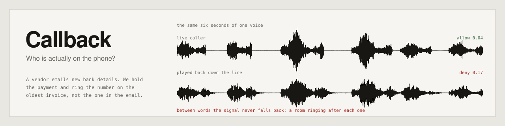
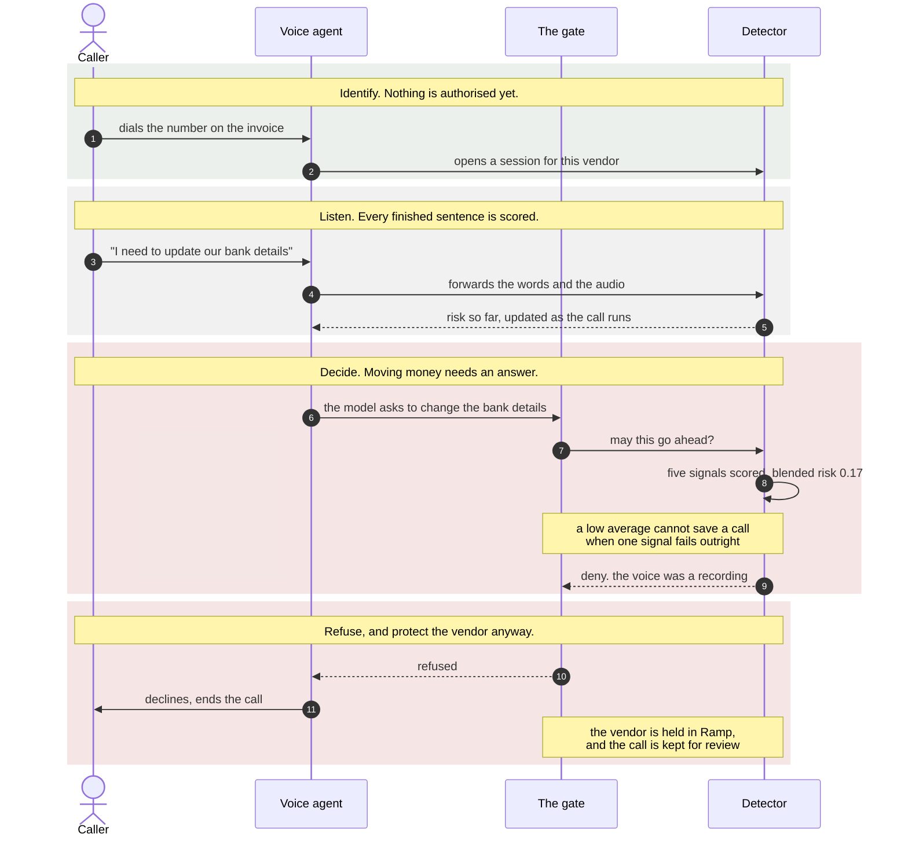
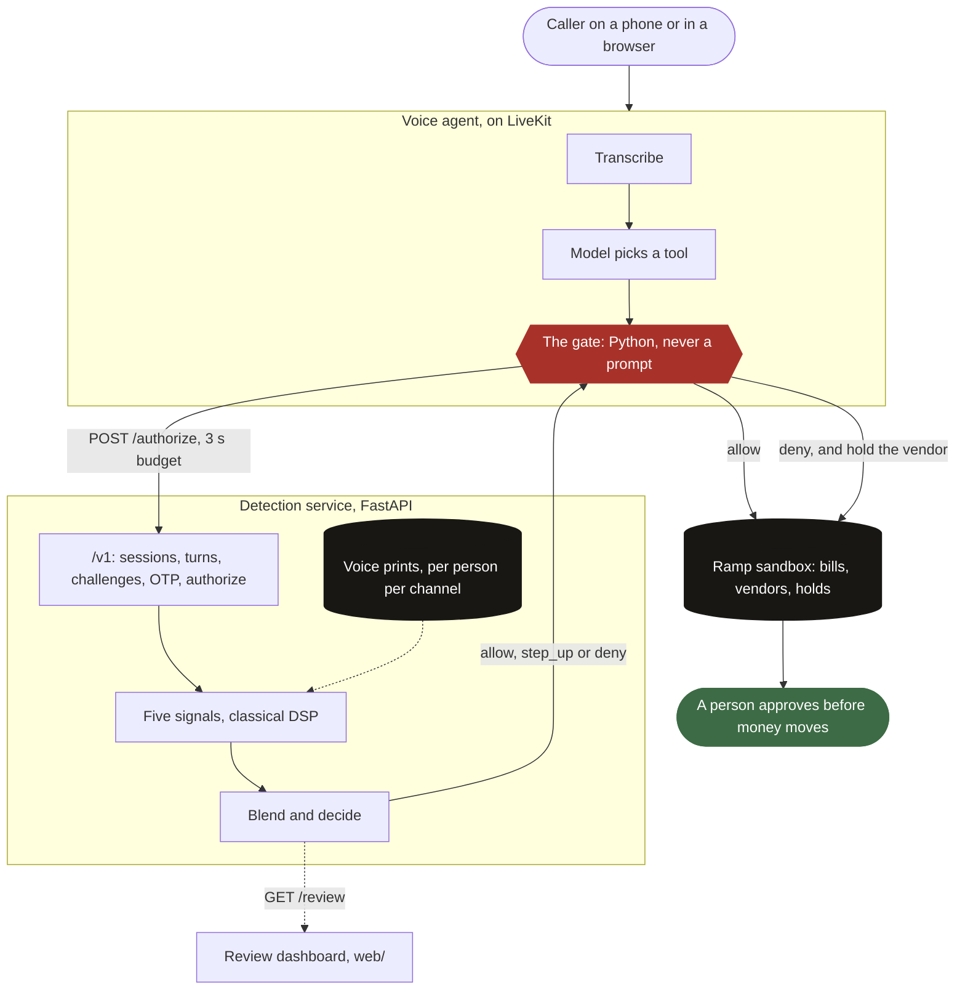
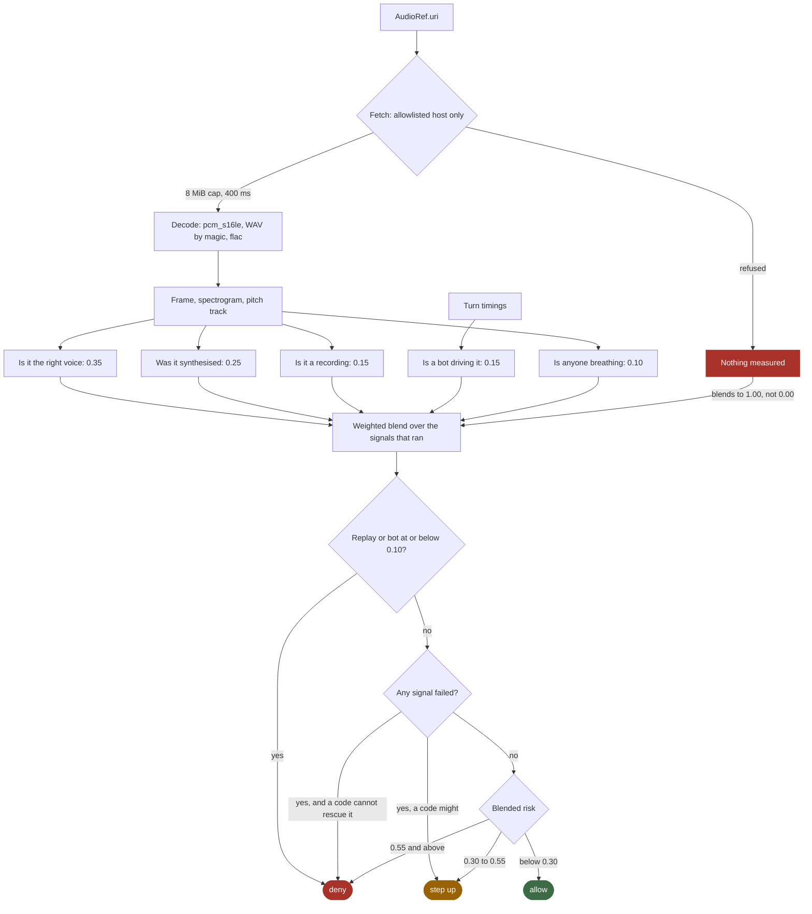

<div align="center">

<picture>
  <source media="(prefers-color-scheme: dark)" srcset="docs/assets/hero-dark.svg">
  
</picture>

[](#running-it)
[](#running-it)
[](shared/src/callback_shared/contract.py)
[](docs/DETECTOR.md)
[](#privacy)
[](#team)

### A voice agent that phones a vendor back to find out whether the person asking to move money is really them.

[What it does](#why-this-matters) &middot; [How a call works](#how-a-call-works) &middot; [Inside the detector](#inside-the-detector) &middot; [What it measures](#what-it-actually-measures) &middot; [Run it](#running-it) &middot; [Limits](#limits)

</div>

---

A vendor emails finance with new bank details. Somebody has to decide whether that email is real before the next invoice pays out to it. Callback holds the payment in Ramp, finds the vendor's phone number on the oldest invoice already on file, and rings **that** number rather than anything in the email. The vendor says the new account out loud, Callback never reads it back to them, and five signals measure the voice while they talk. A person approves in Ramp before any money moves.

> **Status: hackathon build, end to end against Ramp's sandbox, which cannot move real money.** The agent places and runs real calls over LiveKit, the detector measures real audio and answers inside a 3 second budget, voiceprints enrol and compare, and the bank-detail check never reveals the expected digits. 3,463 tests across three suites. The honest ceiling: there is no trained model in the serving path, and the detector's thresholds are calibrated against synthetic audio rather than a corpus of real attacks, so the synthesis detector is the part most likely to underperform against a current commercial clone.

## Why this matters

Voice biometrics alone are broken. In one 2026 study, cloned voices got past a tuned speaker-verification system **43 to 83 percent of the time** depending on the cloning tool ([arXiv 2601.02914](https://arxiv.org/html/2601.02914)). Any system whose answer to "is this really them" is a single voiceprint score is already beaten.

So Callback does not ask one question. It asks five, of a call it placed itself:

- **Is it the right voice?** Compared against a reference enrolled from a call that was already trusted.
- **Was it synthesised?** Vocoder phase, pitch micro-variation, the regularity of the speech and pause rhythm.
- **Is it a recording?** The spectral comb of a loudspeaker, and the reverberant tail of the room it was played into.
- **Is a bot driving the call?** Turn-taking latency that no human produces.
- **Is anyone breathing?** Breath events, pause irregularity, pitch wander.

Then it adds two things a clone cannot fake: a code texted to the number already on file, and a callback to that same number. **We never use a number the caller gives us.**

## How a call works

The call below is the one that matters: a caller who sounds right, asking to change where the money goes, who turns out to be playing a recording.



Had the detector answered `step_up` instead, the agent would have run the factors in order: a **voice challenge** (repeat these digits), then an **SMS code** to the number on file, then a **callback** to that same number. The first failure ends the round, and the rounds are capped.

**The model never decides authorisation.** It can ask for an action; the gate decides, in Python, on the detector's answer. A prompt cannot talk its way past it.

## Architecture



## Inside the detector

Audio arrives as a reference, never inline. Everything below runs per span, and every failure path resolves to deny.



Three details in there are the whole safety argument, and each exists because the obvious version is wrong:

| Rule | Why |
|---|---|
| Nothing measured blends to **1.00**, not 0.00 | "No evidence" and "perfect evidence" must never be the same number. A detector that scored nothing used to read as a detector that found nothing wrong. |
| A failing signal can **never** become an allow | Weights renormalise over the signals that ran, so one failure can be diluted below the allow line by a handful of passes. |
| Replay and bot-driving are **unrescuable** | A correct code does not make a played-back recording legitimate. Those two withhold the step-up, which drops the middle band to deny. |

Spans combine by **lowest score per signal**, never averaged. One clearly bad second of audio is evidence, and averaging it against three clean ones is how a short burst of a recording gets smoothed away.

## What it actually measures

Every number below came out of the real service. `showcase/build.py` drives `detector.app` over its own HTTP interface and records what comes back, so these cannot drift from what the agent receives.

| what the caller sent | no reference voice | reference enrolled |
|---|---|---|
| the real CFO | allow `0.07` | allow `0.04` |
| **a different person reading the script** | **allow `0.05`** | challenge `0.37` |
| the same voice, played back down the line | deny `0.30` | deny `0.17` |
| a synthesiser reading the same script | deny `0.59` | challenge `0.35` |
| a recording first, then a live voice | deny `0.34` | deny `0.20` |
| no audio at all | deny `1.00` | deny `1.00` |
| a span this deployment will not fetch | deny `1.00` | deny `1.00` |

**Read the second row.** With no reference voice on file, a live human reading the attacker's script is *allowed*. Synthesis, replay and liveness all pass a live human at a handset, because a live human at a handset is exactly what those three are looking for. Only the voice comparison would notice, and it cannot run without something to compare against. That is what enrolment is for.

The fourth row goes the other way, and it is the intended policy rather than a regression: a clone of the vendor is **supposed** to match on voice, so the two signals that did catch it become a smaller share of the total. What stops a clone is the texted code, not the blended score.

The detector explains itself in words, not just scores:

```
replay failed at 0.12. Replay channel: fixed 1.2 ms spectral comb, 13.0x the
cepstral baseline (a reflection in the playback path); speech offsets decay at
only 23 dB/s (RT60 ~ 2590 ms), consistent with a room in the path; gaps between
words only 24 dB below speech and spectrally matched to it (r=0.61): a
reverberant tail. 2 of 6 cues flagged.
```

That sentence goes in front of the person deciding whether to release a held payment.

### The five signals

| signal | weight | what it reads |
|---|---|---|
| `voice_match` | **0.35** | Pitch register in semitones, long-term spectral shape, against an enrolled reference. |
| `synthetic_speech` | **0.25** | Vocoder phase jitter, pitch and amplitude perturbation, rhythm regularity, noise floor. |
| `replay` | **0.15** | Cepstral comb from a loudspeaker, offset decay, the level and spectrum of inter-word gaps. |
| `agent_behaviour` | **0.15** | Turn-taking latency and its variance. |
| `liveness` | **0.10** | Breath events, pause irregularity, pitch micro-variation and contour. |

Thresholds: allow below `0.30`, deny at or above `0.55`, step up in between. Either fatal signal at or below `0.10` denies outright. A resolved code carries `0.40` of the blend.

## Rules we don't break

- **The model never decides authorisation.** The gate is Python. It acts only on the decision the detector sends back.
- **Fail closed, on both sides.** A detector that errors, times out or returns nonsense is a deny, and a denied money move also puts the vendor on hold. Inside the detector every failure path resolves to deny.
- **Holding is always allowed.** A hold protects the company, so it never needs verification.
- **A voice match never authorises anything alone.** A high deepfake score overrides any voiceprint score, and a failing signal is never averaged into an allow.
- **We never use a number the caller gives us.** Codes and callbacks go only to the number already on file.
- **The expected bank digits are never spoken, logged or returned.** The caller has to produce them unprompted.
- **No secrets in git.** `.env.example` lists every variable name and no values.

## Privacy

Enrolment stores a **voice print**, never a recording: a median pitch, two durations and a long-term average log spectrum. About 1.6 KB against a quarter of a megabyte of audio, and nothing that was said can be recovered from it, because everything carrying what was said has been averaged away. Prints are stored per person **per channel**, because a handset and a browser microphone put a different frequency response in front of the same larynx.

A person agrees out loud before any print is made, the consent text and their spoken yes are stored with it, and `DELETE /v1/enrollments/{user_id}` erases both channels.

## Repo layout

| Path | Owner | What it does |
|---|---|---|
| `agent/` | Veer | The voice agent on LiveKit: detector client, Ramp client, the gate, the tools the model can call, the step-ups. |
| `detector/` | Eric | The detection service over HTTP: state machine, signal analysis, scoring, enrolment, review surface. |
| `web/` | Veer | The review dashboard. Next.js, reads the detector server-side so the token never reaches the browser. |
| `showcase/` | Eric | A self-contained page showing what the detector hears, built from real measurements. |
| `shared/` | Both | The agent contract (`callback_shared`) and the detector's internal `/events` models. Changed only together. |
| `training/` | Eric | Dataset downloads, features, model training and metrics. No audio in git. |
| `tests/` | Eric | The detector's suites. The agent's are in `agent/tests/`. |
| `schemas/` | Eric | Frozen JSON-schema snapshots, with drift tests. |
| `examples/` | Eric | An agent skeleton and scripts that drive the detector in mock and real mode. |
| `docs/` | Both | The contract, the detector guide, the agent integration guide, the demo runbook, the contract ruling. |
| `ci/` | Eric | The GitHub Actions workflow, parked until the token has `workflow` scope. |

## Running it

Mock mode needs no model and no audio. It plays five scripted calls through the real state machine and the real scoring code.

```bash
CALLBACK_API_TOKEN=kit-test uv run uvicorn detector.app:app --port 8021
uv run python examples/drive_mock.py --base-url http://127.0.0.1:8021 --token kit-test
```

```
scenario        decision  state    risk   factors
real_cfo        allow     allowed  0.045  5 factors, all pass
cloned_voice    allow     allowed  0.262  6 factors, fail: synthetic+liveness
replay          deny      denied   0.386  5 factors, fail: replay+liveness
ai_agent        deny      denied   0.690  5 factors, fail: voice+synthetic+agent+liveness
human_impostor  allow     allowed  0.199  6 factors, fail: voice

all 5 checks behaved as documented.
```

Real mode measures actual waveforms instead:

```bash
CALLBACK_API_TOKEN=kit-test CALLBACK_MOCK_MODE=0 CALLBACK_AUDIO_ENABLED=1 uv run uvicorn detector.app:app --port 8021
uv run python examples/drive_real.py --base-url http://127.0.0.1:8021 --token kit-test
```

That prints the table above, every case run twice, once with a reference voice on file and once without.

Build the showcase page, which needs nothing running:

```bash
uv run python showcase/build.py
```

The tests:

```bash
make test                          # the detector, 1,508
cd shared && uv run pytest         # the contract, 14
cd agent && uv run pytest          # the agent, 1,941
cd web && npm test                 # the dashboard
```

More: [`docs/DETECTOR.md`](docs/DETECTOR.md) to run and understand the detector &middot; [`docs/CONTRACT.md`](docs/CONTRACT.md) for the internal `/events` API &middot; [`docs/AGENT-INTEGRATION.md`](docs/AGENT-INTEGRATION.md) for wiring an agent to it.

## Limits

Named here rather than discovered later.

- **No trained model is in the serving path.** The detector is classical signal processing. A training pipeline exists in `training/` and has run once as a smoke test that scored an EER of 0.50, which is chance. It has never seen real data, because two of the six datasets never finished downloading.
- **The thresholds are calibrated against synthetic audio** generated in this repository, not a corpus of real attacks. The synthesis detector looks for the absence of micro-variation, and a current commercial clone reproduces micro-variation deliberately, so it would very likely do worse there than the numbers above suggest. The replay detector rests on room acoustics, which is physics, and should travel better.
- **`voice_match` is not speaker verification.** It compares pitch register and spectral shape. It catches an obviously different talker and nothing finer. Two people with similar voices match here even when you could tell them apart instantly.
- **The hidden listener is not built, and is no longer the plan.** The detector was designed to join the room and hear the caller itself. Instead the agent captures the caller's speech from the frames it already taps for STT and posts one segment per turn to `/events` inline (`agent/src/callback_agent/audio_segments.py`), tagged `caller` or `callback`; `/v1` reads what those segments measured through `detector/bridge.py`, and a real-mode challenge resolves from the posted turn text plus that evidence. With nothing posted, it still resolves `no_audio`.
- **Nothing is deployed, and CI has never run.** The workflow is parked in `ci/` waiting on a token scope, so every test count here was measured locally.
- **Sessions live in process memory.** One container owns them, and a restart loses them.

## Team

Built by **Eric Catalano** and **Veer Sahasi** for the BBS x Ramp hackathon. Eric built the detection service, the signal analysis, enrolment, scoring and the showcase. Veer built the voice agent, the Ramp integration, the gate and the review dashboard. The contract between them was settled by a written ruling in [`docs/contract/`](docs/contract/) after three independent reviews of 31 conflicts.
