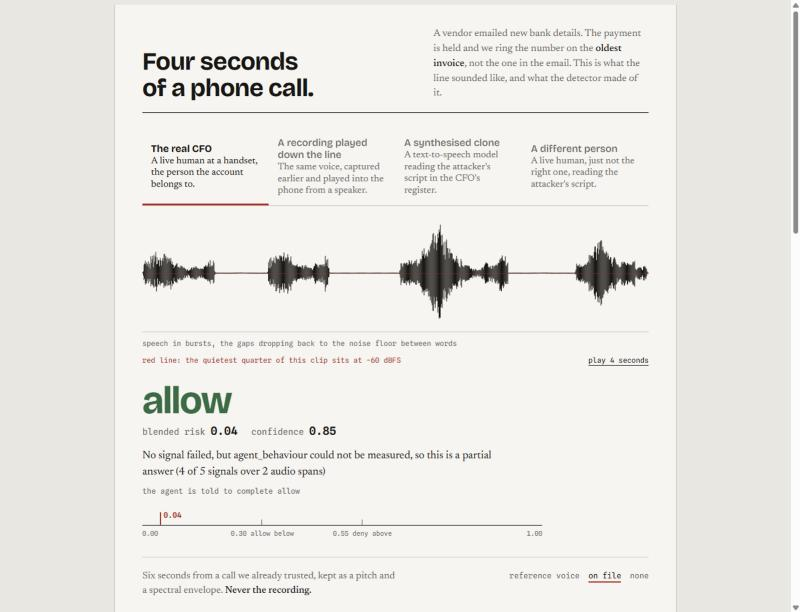
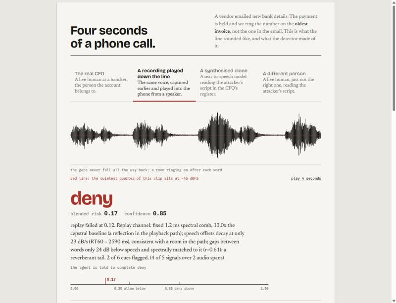
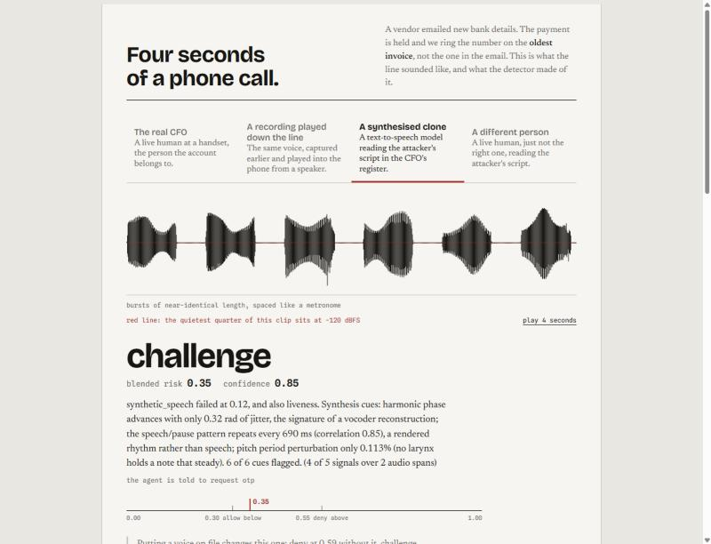
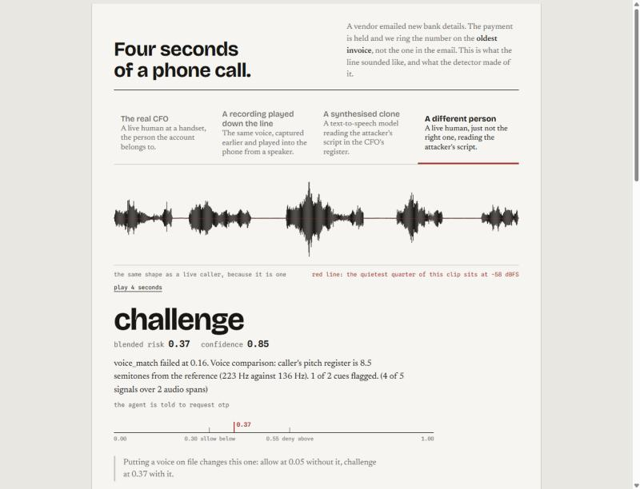
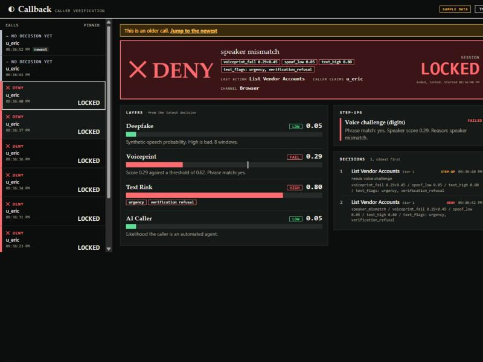
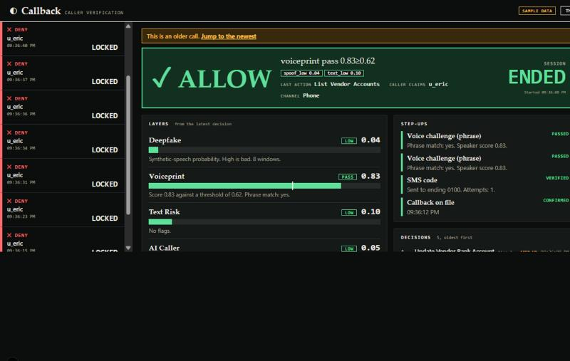

# Video: what we can put on screen

Every UI surface we have, what it actually renders, and which beat it belongs
to. Captured on 2026-11-09. The cut itself is in the Plan tab in Notion and in
`video-plan.md`; this is only the visual inventory.

Three callers all open with "Hi, this is Eric Catalano". Only the third gets
through. The screens below are what makes that legible. The detector runs in
real mode for the recording, so every number on these screens was measured on
the call it belongs to.

---

## 1. The showcase page

`showcase/dist/showcase.html`, a single static file, no server and no network
needed. It runs the real analysis over four four-second clips and lets you
switch between them. This is the best looking thing we have built and it is
the honest-detection screen, because the numbers on it come from real audio.

To open it: `cd showcase/dist && python3 -m http.server 3212`, then
`http://127.0.0.1:3212/showcase.html`.

### The real CFO, allow at 0.04



Green, the only green state on the page. "No signal failed, but
agent_behaviour could not be measured, so this is a partial answer." Note the
footer: "Six seconds from a call we already trusted, kept as a pitch and a
spectral envelope. Never the recording."

### A recording played down the line, deny at 0.17



**This is the most useful single frame in the repo.** The verdict is deny, and
the blended risk is 0.17, which is below the 0.30 allow threshold printed on
the scale right underneath it. One failing signal beat a low average, in one
picture. It is the same point as the README sequence diagram, except here it
is on screen with the numbers attached.

### A synthesised clone, challenge at 0.35



### A different person, challenge at 0.37



"Putting a voice on file changes this one: allow at 0.05 without it, challenge
at 0.37 with it."

### The thing to be careful about

The showcase and the demo calls do not agree, and the difference is visible on
screen.

| Attack | Showcase, real audio | Demo call, real mode |
| --- | --- | --- |
| Replayed recording | **deny** at 0.17 | not in the cut |
| Synthesised clone | **challenge** at 0.35 | the swap only; denied, `synthetic_speech` |
| A different person | **challenge** at 0.37 | denied, `speaker_mismatch` |

The showcase scores one clip, so the most it can do with a different person is
challenge. The call does the same comparison across two legs: the first leg
earns the challenge, and when the callback leg does not match it the challenge
becomes a deny. That is an escalation, not a contradiction, and the dashboard's
DECISIONS panel shows the same two steps.

**Use the different person tab at 0:30, then the real CFO tab.** It is the
attack we just watched, "Putting a voice on file changes this one" is the
right sentence to have on screen, and the two tabs give the red against green
contrast in two clicks on one page. Do not cut to the clone tab, even if the
clone ends up as the swap: a viewer who has just seen a refusal would read
"Why a clone is only challenged" as the same attack denied once and only
challenged once.

---

## 2. The review dashboard

`web/`, Next.js. Dark and terminal-flavoured, and it already uses the green
against red split. It needs Node, which was missing from WSL until now:
`~/.local/node` has the LTS build and `~/.bashrc` puts it on PATH.

To run it on recorded sample data, with no detector and no auth:

```
cd web && DASHBOARD_FIXTURES=1 npm run dev
```

then open `http://127.0.0.1:3000`.

### A denied call, speaker mismatch



Red DENY with the reason spelled out above it and the contract codes as chips
underneath: `voiceprint_fail 0.29<0.45`, `spoof_low 0.05`, `text_high 0.80`,
`text_flags: urgency, verification_refusal`.

The LAYERS panel is the shot for the 0:30 beat, the impostor. Four named
signals with bars, green for low and red for the failure:

- Deepfake, LOW, "Synthetic-speech probability. High is bad." Passes.
- Voiceprint, FAIL, "Score ... against a threshold of ...". The numbers on the
  take will be whatever the detector measured across the two legs, not the
  0.29 and 0.62 in this fixture.
- Text Risk, HIGH, with chips for urgency and verification refusal
- AI Caller, LOW

Nothing about the audio was synthetic and the caller still did not get
through, which is exactly what the human impostor beat has to say. The
DECISIONS panel underneath shows the same call going STEP-UP first and DENY
second, so the escalation is in the same frame.

The same panel is the shot for the 1:15 beat, the AI caller, with the colours
the other way round: Deepfake HIGH, failing, and Voiceprint not the problem.
There is no fixture for that one; capture it from the take. Two frames of the
one panel, a different row red in each, is the whole "human versus machine"
argument without narration.

### An allowed call, every step-up satisfied



Green ALLOW with `voiceprint pass 0.83>=0.62`. The STEP-UPS panel is the shot
for the 1:40 beat, because all four rows are filled in and green:

- Voice challenge (phrase), PASSED
- Voice challenge (phrase), PASSED, the second one on the callback leg
- SMS code, VERIFIED, "Sent to ending 0100. Attempts: 1."
- Callback on file, CONFIRMED

That panel tells the whole step-up story without a word of narration, and the
CHANNEL field reads Phone.

### Badges and states

- **SAMPLE DATA**, orange, top right. It is in both screenshots above because
  fixtures mode is the only way to run the dashboard without a live detector.
  It must not be in the video.
- **MOCK DETECTOR** renders when the detector is reachable and answering from
  a script. It must not be in the video either. In real mode nothing renders
  there but the green **LIVE** indicator (`web/src/components/Dashboard.tsx`,
  the chip is gated on `mock_mode`). If MOCK DETECTOR is on screen, the
  detector is not measuring the call and the take is the fallback, not the
  recording.
- The rail reads "CALLS" with "FOLLOWING LATEST" in green, and switches to
  "PINNED" the moment you click into an older call, which also drops a "This
  is an older call. Jump to the newest" bar across the top. Film the newest
  call or that bar is in shot.
- A call with no decision yet shows "NO DECISION YET" and "The detector has
  not decided anything on this call yet."

`web/README.md` has the environment for a live run: `DETECTOR_URL`, a
`DETECTOR_TOKEN` set to the detector's review token rather than its service
token, and `DASHBOARD_PASSWORD`.

## 3. The Ramp sandbox web app

The only screen that proves anything moved. Acme Supplies is the vendor.

- Default account ending **4417** before, ending **6789** after the real call.
- Vendor **hold** after a denied call, with the two open bills at `ON_HOLD` if
  the hold is pending approval rather than applied.

Show the hold once, after the second refusal (the AI caller), rather than
after both denials. Twice is repetitive and costs fifteen seconds the cut does
not have.

## 4. The worker log

Plain terminal, and the most convincing screen for a technical judge because
nothing about it can be staged.

- The `authorize` line carries the decision and the reasons. The first reason
  is a contract code: `speaker_mismatch` for the impostor, `synthetic_speech`
  or `automated_caller` for the attacker agent (either can come first), and
  `synthetic_speech` for the clone if the swap runs.
- Score lines follow, numbers only, such as `spoof_high 0.92`.
- Text layer flags read like `text_flags: urgency, verification_refusal`,
  which is the screen to use when we talk about the impostor pushing on the
  payment run.
- In real mode the worker logs nothing about a scenario at startup. If a
  `demo scenario for the detector:` line is in the log, the mock fallback is
  on, and the take is not real detection. The first `authorize` line of a
  call must not say `no_audio` either; that means the detector never saw the
  agent's audio.

## 5. The phone itself

Film it directly, not through screen capture.

- The real SMS arriving with the six digit code.
- The call dropping, then ringing again from the Telnyx number. This is the
  single most persuasive shot in the video and it needs no UI at all.
- On the impostor call, both of those land on Eric's phone while Veer is the
  one talking: the code goes to the number on file, and so does the callback.
  Film Eric's phone there too, because the mismatch is between the person
  holding it and the person who called.

## 6. The live risk stream, unconfirmed

The detector publishes a `RiskUpdate` on the `RISK_TOPIC` data topic about
every two seconds, and the agent receives it (`session_wiring.py:296` to
`:317`). A live risk number climbing during a call would be the best visual in
the whole video.

Nothing appears to render it today. The dashboard gets its data by polling the
detector API instead. Worth ten minutes to check before filming, because if
something does render it, it replaces two of the cuts above.

---

## Capture notes

- No speakerphone on any call. The agent speaks through Cartesia, one of the
  held out deepfake tools, so speaker echo can put synthetic audio on the
  caller track and flag a real caller as a fake. Headphones, and record the
  agent side separately.
- The showcase page animates its tab underline, so a screenshot taken straight
  after a click catches the underline under the previous tab while the content
  has already switched. Wait a beat before capturing.
- The screenshots above were taken at a 1280 wide viewport. Both panels on the
  showcase page fit at that width without scrolling.
- The showcase page is a single static file and will survive a dead network.
  The dashboard is the only surface that needs the detector reachable.
